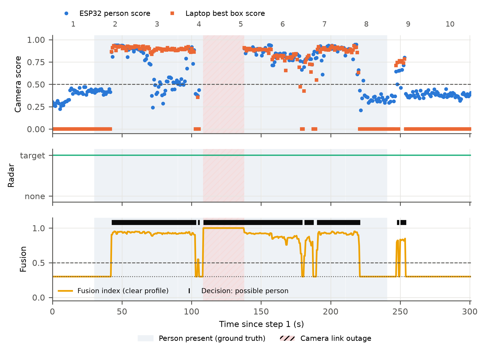
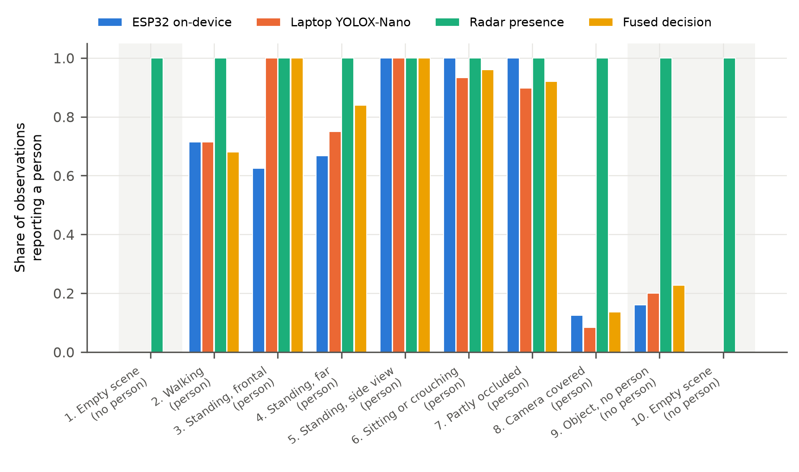
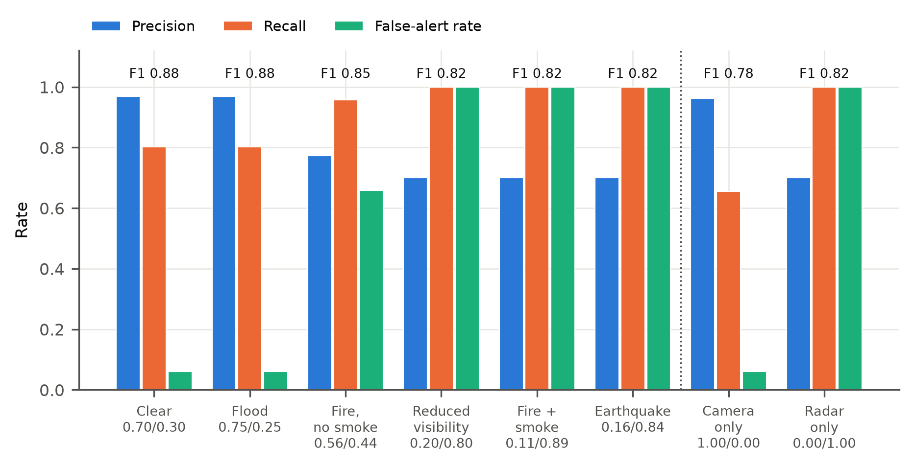
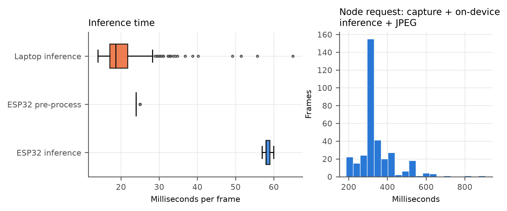
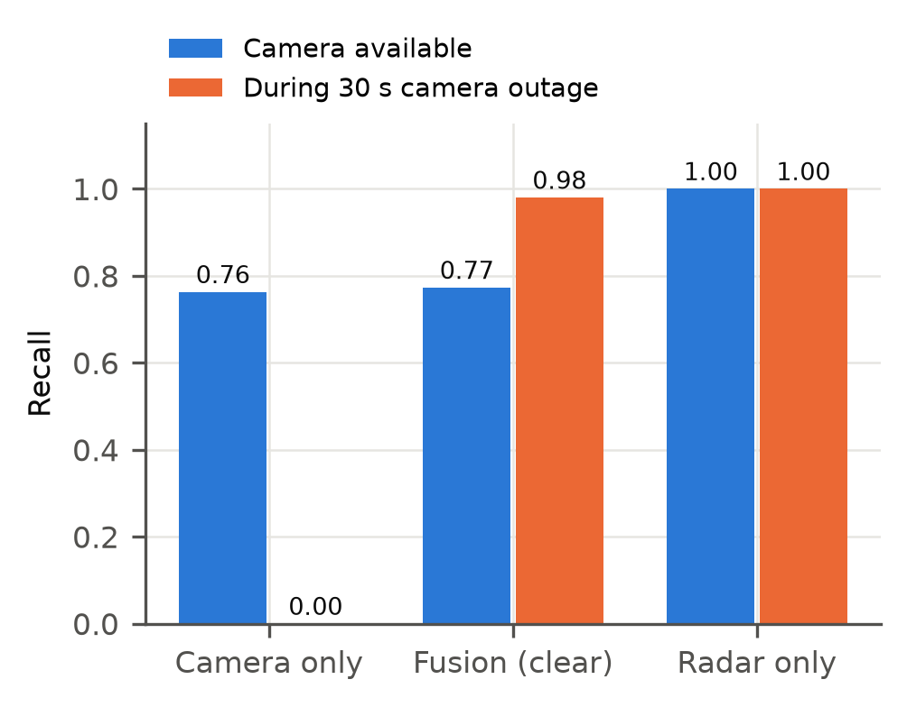

# ARES pilot trial — results for paper and report

Date: 31 October 2026, 07:08–07:13 (Asia/Calcutta). Single guided 300 s session.
Raw data: `benchmarks/trials/2026-10-31T071329-live5min/` (protocol, samples, results.json, timeline.csv,
supplementary.json) and recording `benchmarks/sessions/5f567b455d4642b5a91f46e269b9c9fe/`.

## 1. Setup and method

**Hardware.** ESP32-S3-WROOM-1U (8 MB flash, 8 MB PSRAM, external 2.4 GHz antenna) with an OV7670
camera (320×240 RGB565) on firmware `ares-node-0.3`; HLK 24 GHz presence radar streaming over BLE
(~10 Hz); laptop ground station (FastAPI backend, React dashboard) on a phone Wi-Fi hotspot. The IR
sensor was unavailable; its values are synthetic and carry zero applied weight in every result.

**Detectors.**
- *On-device (ESP32):* TensorFlow Lite Micro `person_detect` (int8, 96×96 grayscale, Apache-2.0),
  ESP-NN optimised, run on every captured frame (centre 240×240 crop) before JPEG encoding; person if
  score ≥ 0.5.
- *Laptop:* YOLOX-Nano (COCO, person class, Apache-2.0) on ONNX Runtime CPU; person if ≥ 1 box with
  score ≥ 0.35.
- *Radar:* the module's presence flag (moving or stationary target).
- *Fusion:* weighted evidence index of camera (best laptop box score) and radar (presence 0/1) with
  missing-input renormalisation, hysteresis (on ≥ 0.5, off ≤ 0.3) and 2-tick persistence (0.5 s tick).

**Protocol.** One participant followed spoken cues for ten 30 s steps: empty scene; walking at ~2 m;
standing frontal; standing far (~3.5 m); side view; crouching; partly occluded behind a chair; camera
lens covered; a bag placed on a chair then the participant leaves; empty scene. Ground truth is
"person inside the marked zone" by protocol timing. The first 3–8 s of each step (moving into
position) are excluded.

**Metrics.** Computed per observation of each source (camera frames for the two detectors, radar
reports, 1 Hz fusion telemetry, 0.5 s fusion replay ticks). Fusion under all condition profiles was
obtained by replaying the live fusion rules on the recorded evidence; weights were **not tuned** on
this session.

## 2. Detection performance

**Table 1 — Per-observation detection performance (300 s session).**

| Source | n | Precision | Recall | F1 | Specificity | False-alert rate | ROC-AUC |
|---|---|---|---|---|---|---|---|
| ESP32 on-device (TFLM, 96×96) | 257 frames | 0.969 | 0.735 | 0.836 | 0.954 | 0.046 | 0.837 |
| Laptop YOLOX-Nano | 257 frames | 0.964 | 0.776 | 0.860 | 0.943 | 0.057 | 0.879 |
| Radar presence flag | 2,481 reports | 0.702 | 1.000 | 0.825 | 0.000 | 1.000 | — |
| Fused decision, live (clear profile) | 248 ticks | 0.966 | 0.805 | **0.878** | 0.932 | 0.068 | — |

**Table 2 — Detection rate by condition** (share of observations reporting a person; for the
person-absent rows this is the false-alert rate).

| Condition | Person | ESP32 | Laptop | Radar | Fused (live) |
|---|---|---|---|---|---|
| Empty scene (start) | no | 0.00 | 0.00 | 1.00 | 0.00 |
| Walking | yes | 0.71 | 0.71 | 1.00 | 0.68 |
| Standing, frontal | yes | 0.63 | 1.00 | 1.00 | 1.00 |
| Standing, far | yes | 0.67 | 0.75 | 1.00 | 0.84 |
| Side view | yes | 1.00 | 1.00 | 1.00 | 1.00 |
| Crouching | yes | 1.00 | 0.93 | 1.00 | 0.96 |
| Partly occluded | yes | 1.00 | 0.90 | 1.00 | 0.92 |
| Camera covered | yes | 0.13 | 0.08 | 1.00 | 0.14 |
| Object, person leaving | no | 0.16 | 0.20 | 1.00 | 0.23 |
| Empty scene (end) | no | 0.00 | 0.00 | 1.00 | 0.00 |

The "object" false alerts all fall 6–12 s after the cue, while the participant was still placing the
bag and leaving. Excluding the first 13 s, **neither detector flagged the bag: 0/20 frames each**
(supplementary.json).

## 3. On-device (ESP32) versus laptop inference

**Table 3 — Edge versus laptop.**

| | ESP32-S3 (on-device) | Laptop |
|---|---|---|
| Model | TFLM person_detect, int8, 96×96 gray | YOLOX-Nano, fp32, 416×416 |
| Output | person score per frame | boxes (count, location) |
| Inference p50 / p95 / max | **58 / 59 / 60 ms** | 18.7 / 30.4 / 65 ms |
| Pre-processing p50 / p95 | 24 / 25 ms (crop, downscale, grayscale) | included above |
| Model memory | 122,572 B tensor arena (internal SRAM) | — |
| Firmware size | 1.41 MB (42% of 3.34 MB app partition) | — |
| F1 / ROC-AUC (Table 1) | 0.836 / 0.837 | 0.860 / 0.879 |
| Agreement on the same 257 frames | 92.2%, Cohen's κ = **0.844** | |

The on-device result travels with each image in HTTP headers, so the laptop receives a person
decision with every frame without running its own model. The ESP32 timing is deterministic (p95 within
1 ms of p50).

## 4. Fusion under operator-selected condition profiles

**Table 4 — Fusion replay on the recorded evidence (0.5 s ticks; IR applied weight 0).**

| Profile | Applied camera / radar | Basis | Precision | Recall | F1 | False-alert rate |
|---|---|---|---|---|---|---|
| Clear | 0.70 / 0.30 | provisional | 0.969 | 0.802 | **0.878** | 0.06 |
| Flood | 0.75 / 0.25 | literature prior | 0.969 | 0.802 | 0.878 | 0.06 |
| Fire, no smoke | 0.56 / 0.44 | literature prior | 0.773 | 0.957 | 0.855 | 0.66 |
| Reduced visibility | 0.20 / 0.80 | provisional | 0.700 | 1.000 | 0.824 | 1.00 |
| Fire with smoke | 0.11 / 0.89 | literature prior | 0.700 | 1.000 | 0.824 | 1.00 |
| Earthquake / rubble | 0.16 / 0.84 | literature prior | 0.700 | 1.000 | 0.824 | 1.00 |
| Camera only (baseline) | 1.00 / 0.00 | baseline | 0.962 | 0.655 | 0.779 | 0.06 |
| Radar only (baseline) | 0.00 / 1.00 | baseline | 0.700 | 1.000 | 0.824 | 1.00 |

Camera-led profiles keep the camera's precision; radar-led profiles inherit the radar's recall and
also its false alerts. In this room the radar never reported an empty scene (Section 6), so every
radar-dominant profile alarmed throughout the empty steps.

## 5. Graceful degradation during a camera link outage

A 29.7 s camera link outage occurred during the "far" and "side view" steps (laptop requests timed out:
25 connect and 4 read timeouts; the ESP32 kept running and did not reboot; the feed recovered without
intervention).

**Table 5 — Recall during versus outside the outage (person present throughout the outage).**

| | During outage (49 ticks) | Outside outage (448 ticks): precision / recall / F1 / false-alert |
|---|---|---|
| Camera only | **0.00** | 0.962 / 0.763 / 0.851 / 0.06 |
| Fusion, clear profile | **0.98** | 0.963 / 0.773 / 0.858 / 0.06 |
| Radar only | 1.00 | 0.667 / 1.000 / 0.800 / 1.00 |

Fusion matched camera-only performance when the camera was available and kept detecting the person when
it was not, because a missing input is renormalised rather than read as "no person". The dashboard showed
this as partial coverage, not as an all-clear.

## 6. System performance

| Measure | Result |
|---|---|
| Session duration | 300.8 s |
| Camera frame rate (laptop) | 1.05 fps (includes the 30 s outage; 1.22 fps in an earlier 60 s run) |
| ESP32 result present | 100% of received frames |
| Node request time (capture + on-device inference + JPEG), p50 / p95 | 328 / 531 ms |
| Backend frame age p50 / p95 | 438 / 812 ms |
| Radar report rate | 10.0 Hz |
| Camera availability | 90.7% of polls (one outage) |
| Entry detection | first camera detection 12.4 s after the entry cue, i.e. when the participant arrived; fused decision 0.8 s after the first camera detection (persistence) |

## 6b. Resource footprint, CPU load and energy

Each figure is labelled **M** (measured on our hardware/build), **D** (derived from measured values) or
**E** (estimate from manufacturer datasheets — no current or voltage was measured in this work).

**Table 6 — ESP32-S3 node memory (firmware `ares-node-0.3`, 240 MHz, 8 MB flash, 8 MB PSRAM).**

| Resource | Value | Share | Basis |
|---|---|---|---|
| Firmware image | 1,405,299 B | 42.0% of 3,342,336 B app partition | M (compiler) |
| — added by on-device inference | **374,524 B** | 11.2% of partition (0.2 → 0.3 image) | M |
| — person_detect model weights | 300,568 B | 21.4% of image | M (model file / map) |
| — TensorFlow Lite Micro + ESP-NN code | 68,531 B | 4.9% of image | M (linker map) |
| — camera driver | 67,413 B | 4.8% | M (linker map) |
| — ARES application | 105,563 B | 7.5% | M (linker map) |
| — ESP-IDF, Arduino, Wi-Fi/BT stacks, other | 863,224 B | 61.4% | D (image − above) |
| Static internal RAM (.data + .bss) | 66,760 B | 20.4% of 327,680 B DRAM | M (compiler) |
| IRAM code | 80,896 B | — | M (ELF sections) |
| Tensor arena (internal SRAM) | 122,572 B used of 143,360 B allocated | 85.5% used | M (TFLM at boot) |
| Free internal heap at runtime | 56.4–56.6 KB with model; 201.0 KB without | model costs ≈ 144.5 KB | M (`/health`) |
| PSRAM in use | ≈ 324–332 KB of 8 MB | ≈ 4% (two 153,600 B RGB565 frame buffers + JPEG) | M (`/health`), unchanged by inference |

**Table 7 — CPU load.**

| Platform | Measure | Value | Basis |
|---|---|---|---|
| ESP32-S3 | Compute per frame (pre-process + inference) | 24 + 58 = **82 ms** on one core | M (341 frames) |
| ESP32-S3 | Cycles per inference | ≈ 13.9 M (58 ms × 240 MHz) | D |
| ESP32-S3 | Inference CPU load at the trial rate (1.05 fps) | **8.6% of one core** (4.3% of both cores) | D |
| ESP32-S3 | Same at 1.22 fps (pipeline run 3) | 10.0% of one core (5.0% of both) | D |
| ESP32-S3 | Compute-bound ceiling with a dedicated core | ≈ 12 inferences/s | D |
| Laptop (Ryzen 7 260, 8C/16T) | YOLOX-Nano wall-clock duty at 1.05 fps | 2.0% (18.7 ms × 1.05/s) | D |
| Laptop | Upper bound with all 8 inference threads busy | ≤ 1% of the 16 logical CPUs | D |

Total node CPU utilisation (Wi-Fi, HTTP, JPEG, camera DMA) was not instrumented. FreeRTOS run-time
statistics are enabled in the build (`CONFIG_FREERTOS_GENERATE_RUN_TIME_STATS=y`), so a follow-up
firmware can report measured per-task CPU %.

**Table 8 — Power and energy (estimates; ESP32 at 3.3 V, 25 °C, typical datasheet currents).**

| Item | Datasheet current/power | Estimate | Basis |
|---|---|---|---|
| ESP32-S3, both cores idle, 240 MHz | 32.9–47.6 mA (peripheral clocks off–on) | 109–157 mW | E [1] Table 5-9 |
| ESP32-S3, one core running 128-bit (SIMD) instructions, 240 MHz | 72.4–87.9 mA | 239–290 mW | E [1] Table 5-9 |
| ESP32-S3 Wi-Fi TX (802.11n HT20 MCS7 @ 18.5 dBm / 11b @ 21 dBm), peak | 283–340 mA | 0.93–1.12 W | E [1] Table 5-7 |
| ESP32-S3 Wi-Fi RX | 88–91 mA | ≈ 0.29–0.30 W | E [1] Table 5-7 |
| OV7670 camera (24 MHz, 30 fps; we run 8 MHz XCLK) | 10 mA @ 1.8 V + 8 mA @ 2.5 V | ≈ 38 mW (upper bound) | E [2] DC table notes a, b |
| 24 GHz radar (Seeed, separately powered) | 79 mA average @ 3.3 V | ≈ 261 mW | E [3] §7 Table 2 |
| **ESP32 energy per inference — marginal** (core active vs idle: +18.3 to +40.3 mA, 58 ms) | | **≈ 3.5–7.7 mJ** | D from E |
| ESP32 energy per inference — whole chip during inference (65.9–87.9 mA, 58 ms, radio idle) | | ≈ 12.6–16.8 mJ | D from E |
| ESP32 energy per frame incl. pre-processing (82 ms), marginal / whole chip | | ≈ 5.0–10.9 / 17.8–23.8 mJ | D from E |
| Laptop energy per YOLOX inference, TDP envelope (45 W × 18.7 ms) | default TDP 45 W [4] | **≤ 0.84 J** (upper bound) | D from E |

Interpretation: by these estimates an on-device inference costs millijoules, roughly one to two
orders of magnitude below the laptop's TDP envelope per inference, although the ESP32 is ~3× slower.
On the node, radio transmission (283–340 mA peak) draws several times the current of the inference core
(+18–40 mA), and every frame currently sends a ~28 KB JPEG — so sending results instead of images
(event-triggered transmission, ACTION_PLAN E1) is likely the larger energy saving. These are estimates:
the module's PSRAM and flash add current not covered by the chip figures, and laptop package power
during a 19 ms burst was not logged.

**How to replace the estimates with measurements.** Node: an inline USB power meter or INA219/INA226 on
the supply, three 60 s runs at the same capture rate — (a) Wi-Fi connected, no captures; (b) captures with
inference disabled; (c) captures with inference enabled — then energy per inference = (P_c − P_b) × T / N.
This needs a firmware switch to disable inference (small change). Laptop: log CPU package power (e.g.
AMD uProf or HWiNFO) with the detector on and off (`ARES_DETECTOR=0`) at the same frame rate.

Sources: [1] Espressif, *ESP32-S3 Series Datasheet* v2.2, §5.6, Tables 5-7 and 5-9 (pp. 66–67).
[2] OmniVision, *OV7670/OV7171 CMOS VGA CameraChip* datasheet v1.01 (2005), DC characteristics, notes a–b.
[3] Seeed Studio, *24GHz mmWave Sensor for XIAO – Human Static Presence* user manual V1.00, §7 Table 2 (p. 17).
[4] AMD, Ryzen 7 260 product specifications (amd.com, accessed 31 October 2026): 8 cores/16 threads,
default TDP 45 W, cTDP 35–54 W.

## 7. Key findings (for the paper)

1. A 96×96 int8 person classifier runs on the ESP32-S3 camera node in **58 ms** per frame with a
   122 KB arena in internal SRAM, alongside image streaming.
2. On the same live frames, the on-device classifier reached **F1 0.836 (AUC 0.837)** versus
   **F1 0.860 (AUC 0.879)** for a laptop YOLOX-Nano detector, with **κ = 0.844** agreement.
3. Camera-radar fusion matched camera-only accuracy when the camera worked (F1 0.858 vs 0.851, both
   6% false alerts) and maintained **98% recall during a 30 s camera link outage**, where camera-only
   fell to 0%.
4. Both camera detectors handled side view, crouching and partial occlusion (≥ 0.90 detection) and
   did not flag an inanimate object (0/20 frames), but failed when the lens was covered (≤ 0.13), where
   only the radar responded.
5. At factory settings the radar's presence flag had **no specificity** in this room (it reported a
   target 100% of the time, including empty steps), so radar-dominant disaster profiles produced
   continuous false alerts. Radar gate/sensitivity calibration is the prerequisite for using those
   profiles.
6. On-device inference added **374.5 KB of flash** (11.2% of the app partition; 300.6 KB of it model
   weights) and **≈ 144.5 KB of internal heap** (122.6 KB arena in use), and used **8.6% of one CPU
   core** at the trial frame rate. Datasheet-based estimates put it at **≈ 3.5–7.7 mJ per inference**
   (marginal), versus an upper bound of 0.84 J for the laptop CPU (45 W TDP × 18.7 ms); measurement with
   a power meter is required before quoting energy as a result.

## Figures

Files in `docs/results/figures/` as PNG (300 dpi) and PDF; regenerate with
`python -m ares.figures ../benchmarks/trials/2026-10-31T071329-live5min`.



**Figure 1 — Live trial timeline.** Top: per-frame person score from the on-device ESP32 classifier and
the best laptop YOLOX-Nano box score (dashed line: 0.5). Middle: radar presence flag. Bottom: fusion
index under the clear profile (dashed/dotted: on/off thresholds) with ticks where the fused decision
was "possible person". Grey bands: person present (ground truth); hatched: 30 s camera link outage.
Numbers along the top are protocol steps.



**Figure 2 — Detection rate by condition.** Share of observations reporting a person for each source.
Grey-shaded conditions have no person in the zone, so their bars are false alerts. Object-step false
alerts occurred while the participant was leaving; after 13 s neither camera detector flagged the bag.



**Figure 3 — Fusion under each condition profile.** Precision, recall and false-alert rate when the
fusion rules are replayed on the recorded evidence with each profile's applied camera/radar weights
(IR applied as 0); F1 above each group. Right of the dotted line: single-sensor baselines.



**Figure 4 — Inference time.** Left: per-frame inference on the ESP32-S3 (TFLM, int8, 96×96) and its
pre-processing, versus YOLOX-Nano on the laptop CPU. Right: full node request time (capture, on-device
inference, JPEG encoding and transfer).



**Figure 5 — Graceful degradation.** Recall with the camera available versus during the 30 s camera
link outage. Camera-only detection stops; fusion keeps detecting through the radar.

## 8. Limitations and threats to validity

- One participant, one indoor room, one 5-minute session: a pilot, not a generalisable accuracy claim.
  No confidence intervals are reported because consecutive frames are strongly correlated.
- Ground truth is protocol timing, not frame-level annotation; transitions are handled by fixed settle
  windows, and the participant's arrival and exit times varied (≈12 s).
- Radar empty-scene readings (targets at ~2.5–3.5 m) may reflect the participant remaining within radar
  range during the empty steps, static clutter at default sensitivity, or both; this session cannot
  separate them.
- The "far" step showed a radar range of ~2 m, so the intended 3.5 m distance is not confirmed.
- Profile weights are provisional or literature priors and were not tuned; disaster profiles were
  exercised on a lab scene, not in fire, smoke, flood or rubble. The camera-covered step is an
  optical-blockage proxy, not smoke.
- IR is synthetic and excluded from all metrics. Camera/radar spatial alignment is unverified.
- The camera link outage was not induced; its cause (Wi-Fi link to the hotspot) is inferred from
  timeout types.

## 9. Reproduce

```text
cd ground_station
python -m ares.trial --countdown-s 20 --label live5min     # guided session, spoken cues
python -m ares.analyse_trial ../benchmarks/trials/<folder> # tables -> results.md / results.json
```

Model hashes: YOLOX-Nano `c789161e…0b7d`; TFLM person_detect `808cfdfc…2e9d` (full values in
`docs/validation/detector-2026-10-31.md` and `docs/validation/edge-and-scene-2026-10-31.md`).
